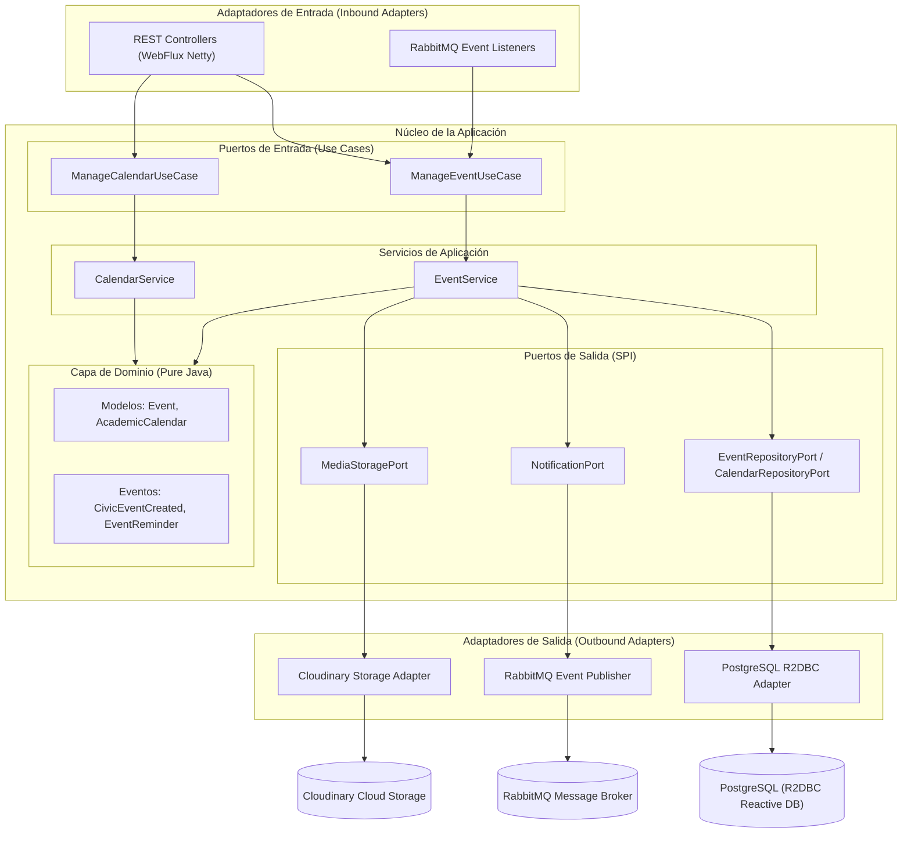

# SIGEI - Microservicio Reactivo de Eventos y Calendarios Cívicos (`vg-ms-civic-dates`)

Microservicio reactivo de alto rendimiento desarrollado con **Spring Boot 4**, **Java 17** y **Spring WebFlux** bajo los principios de **Arquitectura Hexagonal (Puertos y Adaptadores)**. Diseñado para la programación, difusión y gestión asíncrona no bloqueante de eventos institucionales y calendarios cívico-académicos dentro del ecosistema SIGEI (Sistema Integrado de Gestión Educativa Institucional), con persistencia reactiva en PostgreSQL vía R2DBC, mensajería asíncrona con RabbitMQ y almacenamiento de imágenes en Cloudinary.


---

## 1. Funcionalidades Principales

- **Programación Reactiva No Bloqueante**: Pipeline de procesamiento asíncrono con `Mono` y `Flux` basado en Netty y Reactive Streams para soportar alta concurrencia con bajo consumo de memoria.
- **Gestión de Calendarios y Eventos Cívicos**: Ciclo de vida completo para calendarios académicos institucionales y asociación dinámica de efemérides y eventos cívicos.
- **Persistencia Reactiva (R2DBC)**: Acceso no bloqueante a base de datos PostgreSQL utilizando Spring Data R2DBC.
- **Integración Asíncrona Orientada a Eventos**: Publicación de eventos de dominio (`CivicEventCreated`, `EventReminderEvent`) hacia **RabbitMQ** para consumo por otros microservicios del ecosistema SIGEI.
- **Gestión Multimedia en la Nube**: Subida y gestión de afiches y fotografías de eventos mediante integración con la API de **Cloudinary**.
- **Quality Gates Estrictos**: Cobertura de código auditada con **JaCoCo** (mínimo exigido del 80% en líneas y 60% en ramas) y análisis estático continuo con **SonarQube**.
- **Pruebas de Carga Gradual con JMeter**: Planes de prueba `.jmx` integrados para evaluación de rendimiento bajo escenarios de estrés (Verde, Amarillo y Rojo).

---

## 2. Stack Tecnológico

| Tecnología | Rol en el Proyecto |
| :--- | :--- |
| **Java 17** | Lenguaje de desarrollo backend con soporte para tipos de datos inmutables (Records) y APIs modernas. |
| **Spring Boot 4.0.2** | Framework base para microservicios con soporte nativo para arquitecturas reactivas. |
| **Spring WebFlux / Project Reactor** | Framework HTTP reactivo no bloqueante basado en eventos (`Mono` y `Flux`) sobre servidor Netty. |
| **Spring Data R2DBC** | Driver y abstracción reactiva de acceso a datos para PostgreSQL (`r2dbc-postgresql`). |
| **Spring AMQP / RabbitMQ** | Broker de mensajería para arquitectura orientada a eventos (*Event-Driven Architecture*). |
| **Spring Security / OAuth2** | Seguridad perimetral con soporte de Resource Server para validación de tokens JWT (Keycloak). |
| **Cloudinary SDK** | Servicio cloud para optimización y almacenamiento seguro de recursos multimedia. |
| **JaCoCo 0.8.11** | Motor de métricas de cobertura de código con umbrales de fallo en compilación (*build-breaker*). |
| **Apache JMeter** | Herramienta de pruebas de rendimiento, estrés y concurrencia sobre los endpoints reactivos. |
| **Docker & Docker Compose** | Contenedorización del microservicio y orquestación local con base de datos PostgreSQL. |
| **Jenkins & GitLab CI** | Pipelines declarativos de integración continua para build, test, análisis SonarQube y despliegue. |

---

## 3. Arquitectura del Sistema

El microservicio está estructurado estrictamente bajo **Arquitectura Hexagonal (Ports & Adapters)** con desacoplamiento total de la lógica de negocio respecto a frameworks y tecnologías de infraestructura:

- **Dominio (`domain`)**: Contiene los modelos puros de negocio (`CivicDate`, `AcademicCalendar`), eventos de dominio y la definición de contratos mediante **Puertos de Entrada** (`port/in`: casos de uso) y **Puertos de Salida** (`port/out`: persistencia, mensajería y almacenamiento externo).
- **Aplicación (`application`)**: Implementa los casos de uso a través de servicios de aplicación (`EventService`, `CalendarService`), DTOs de entrada/salida y mappers de transformación.
- **Infraestructura (`infrastructure`)**:
  - **Adaptadores de Entrada (`adapter/in`)**: Controladores REST reactivos (`EventController`, `CalendarController`) y listeners de mensajería AMQP.
  - **Adaptadores de Salida (`adapter/out`)**: Implementaciones R2DBC para PostgreSQL, publicador de eventos RabbitMQ y cliente externo de Cloudinary.
  - **Configuración (`config`)**: Seguridad reactiva, inicialización de clientes R2DBC, RabbitMQ y Cloudinary.



---

## 4. Estructura del Proyecto

```text
sigei-ms-eventos/
├── src/
│   ├── main/
│   │   ├── java/pe/edu/vallegrande/sigei/civicDates/
│   │   │   ├── application/               # Capa de Aplicación
│   │   │   │   ├── dto/                   # DTOs de entrada y salida (request / response)
│   │   │   │   ├── mapper/                # Conversores entre entidades y DTOs
│   │   │   │   └── service/               # Implementación de casos de uso (EventService, etc.)
│   │   │   ├── domain/                    # Capa de Dominio (Núcleo desacoplado)
│   │   │   │   ├── event/                 # Eventos de dominio (CivicEventCreated, etc.)
│   │   │   │   ├── exception/             # Excepciones específicas del negocio
│   │   │   │   ├── model/                 # Modelos de dominio puros
│   │   │   │   └── port/                  # Puertos (in: Casos de uso / out: SPI Repositorios)
│   │   │   ├── infrastructure/            # Capa de Infraestructura
│   │   │   │   ├── adapter/
│   │   │   │   │   ├── in/rest/           # Controladores REST reactivos (EventController, CalendarController)
│   │   │   │   │   └── out/               # Adaptadores R2DBC, RabbitMQ y Cloudinary
│   │   │   │   ├── common/                # Respuestas estandarizadas (ApiResponse) y ExceptionHandler
│   │   │   │   └── config/                # Configuraciones de WebFlux Security, R2DBC y AMQP
│   │   │   └── CivicDatesApplication.java # Punto de entrada del microservicio
│   │   └── resources/
│   │       ├── application.yaml           # Configuración base del servicio
│   │       ├── application-dev.yml        # Perfil de desarrollo local con base H2/Postgres
│   │       ├── application-prod.yml       # Perfil de producción con variables de entorno
│   │       ├── schema.sql                 # Script DDL de tablas reactivas
│   │       └── data.sql                   # Datos iniciales para pruebas
│   └── test/java/                         # Suite completa de tests con WebTestClient y StepVerifier
├── civic-dates-load-test-*.jmx            # Planes de prueba de carga con Apache JMeter (Verde, Amarillo, Rojo)
├── docker-compose.yml                     # Orquestación de PostgreSQL y Microservicio local
├── Dockerfile                             # Empaquetado multietapa optimizado
├── Jenkinsfile                            # Pipeline CI/CD declarativo para Jenkins
├── .gitlab-ci.yml                         # Pipeline CI/CD para GitLab
├── sonar-project.properties               # Configuración de análisis estático SonarQube
├── pom.xml                                # Dependencias Maven y configuración de plugins (JaCoCo)
└── README.md                              # Documentación técnica del repositorio
```

---

## 5. Seguridad & Autenticación

- **Seguridad Reactiva**: Implementada mediante `ServerHttpSecurity` y `@EnableWebFluxSecurity`.
- **Integración OAuth2 Resource Server**: Diseñado para validar tokens JWT emitidos por el servidor central de identidad **Keycloak** (`/realms/sigei`).
- **Control Perimetral**: En perfiles de producción, los endpoints administrativos requieren claims válidos en el token Bearer, mientras que las consultas públicas de calendario se exponen para el portal estudiantil.

---

## 6. Especificación de Endpoints de la API

Base URL local: `http://localhost:9085`

| Módulo | Método | Endpoint | Retorno Reactivo | Descripción |
| :--- | :---: | :--- | :---: | :--- |
| **Eventos** | `GET` | `/api/v1/events` | `Flux<ApiResponse<EventResponse>>` | Lista reactiva de todos los eventos registrados. |
| **Eventos** | `GET` | `/api/v1/events/{id}` | `Mono<ApiResponse<EventResponse>>` | Consulta de evento por ID. |
| **Eventos** | `POST` | `/api/v1/events` | `Mono<ApiResponse<EventResponse>>` | Registro de nuevo evento institucional. |
| **Eventos** | `PUT` | `/api/v1/events/{id}` | `Mono<ApiResponse<EventResponse>>` | Actualización de datos de un evento. |
| **Eventos** | `DELETE`| `/api/v1/events/{id}` | `Mono<ApiResponse<Void>>` | Eliminación lógica de un evento. |
| **Calendarios**| `GET` | `/api/v1/calendars` | `Flux<ApiResponse<CalendarResponse>>`| Listado de calendarios académicos activos. |
| **Calendarios**| `GET` | `/api/v1/calendars/{id}` | `Mono<ApiResponse<CalendarResponse>>`| Consulta de calendario académico por ID. |
| **Calendarios**| `POST` | `/api/v1/calendars` | `Mono<ApiResponse<CalendarResponse>>`| Creación de nuevo calendario anual/período. |
| **Calendarios**| `POST` | `/api/v1/calendars/{id}/events` | `Mono<ApiResponse<CalendarWithEventsResponse>>` | Asociación de eventos a un calendario. |

### Ejemplo: Consulta de Evento (`GET /api/v1/events/1`)

**Response (`200 OK`):**
```json
{
  "success": true,
  "message": "Event retrieved successfully",
  "data": {
    "id": 1,
    "title": "Día del Logro Institucional",
    "description": "Exposición de proyectos finales de ciclo académico",
    "eventDate": "2025-11-20",
    "status": "ACTIVO",
    "imageUrl": "https://res.cloudinary.com/.../event1.jpg"
  }
}
```

---

## 7. Cómo Ejecutar Localmente

### Requisitos Previos
- **Java 17 JDK**.
- **Docker y Docker Compose**.
- **Maven** (o utilizar el wrapper `./mvnw` incluido).

### Opción A: Levantar todo con Docker Compose (Recomendado)

Inicia automáticamente una instancia de **PostgreSQL 16** con healthcheck y compila el microservicio en el puerto `9085`:

```bash
docker-compose up -d --build
```

Verificar el estado del servicio:
```bash
curl http://localhost:9085/actuator/health
```

---

### Opción B: Ejecución Local con Maven Wrapper

1. **Configurar variables de entorno:**
   Crear un archivo `.env` basado en [.env.example](.env.example):
   ```env
   SERVER_PORT=9085
   SPRING_PROFILES_ACTIVE=dev
   VPC_DB_HOST=localhost:5432
   VPC_DB_NAME=civic_dates
   VPC_DB_USERNAME=postgres
   VPC_DB_PASSWORD=postgres
   CLOUDINARY_CLOUD_NAME=tu_cloud_name
   CLOUDINARY_API_KEY=tu_api_key
   CLOUDINARY_API_SECRET=tu_api_secret
   ```

2. **Compilar y ejecutar:**
   ```bash
   ./mvnw clean compile
   ./mvnw spring-boot:run
   ```

---

## 8. Pruebas Automatizadas y Calidad

### Pruebas Unitarias y de Integración Reactivas
El proyecto cuenta con una amplia suite de pruebas que utiliza `WebTestClient`, `StepVerifier` y `Mockito`:
```bash
./mvnw clean test
```

### Reporte de Cobertura de Código (JaCoCo)
El plugin de JaCoCo evalúa automáticamente que el código cumpla con los estándares mínimos de calidad (**>80% en líneas**):
```bash
./mvnw verify jacoco:report
```
*El reporte interactivo en HTML se genera en `target/site/jacoco/index.html`.*

### Pruebas de Carga y Estrés (Apache JMeter)
El repositorio incluye planes de prueba listos para ejecutar con JMeter:
- `civic-dates-load-test-verde.jmx`: Carga nominal esperada.
- `civic-dates-load-test-amarillo.jmx`: Carga con tráfico elevado y concurrencia media.
- `civic-dates-load-test-rojo.jmx`: Carga de estrés extremo para medición del punto de saturación y degradación.

```bash
jmeter -n -t civic-dates-load-test-verde.jmx -l resultado-verde.jtl
```

---

## 9. Pipelines de CI/CD

El repositorio implementa dos definiciones de integración continua profesionales:

1. **Jenkinsfile (Pipeline Declarativo)**:
   - **Checkout**: Descarga del código fuente desde Git.
   - **Build & Test**: Compilación y ejecución de tests reactivos.
   - **SonarQube Analysis**: Escaneo estático de deuda técnica, vulnerabilidades y *code smells*.
   - **JaCoCo Quality Gate**: Verificación del umbral del 80% de cobertura antes de permitir el merge.
2. **GitLab CI (`.gitlab-ci.yml`)**:
   - Etapas de `build`, `test`, `quality` y generación de imagen Docker para despliegue en entornos de staging.

---

## 10. Rol y Aportes en el Proyecto

- **Desarrollador Backend**: Lorenzo Campos
- **Aportes técnicos destacados**:
  - Implementación de la **Arquitectura Hexagonal**, desacoplando el núcleo de dominio de los adaptadores de infraestructura.
  - Modelado y persistencia reactiva no bloqueante sobre PostgreSQL utilizando **Spring Data R2DBC**.
  - Desarrollo de endpoints reactivos en **Spring WebFlux** exponiendo flujos `Mono` y `Flux` para alta concurrencia.
  - Diseño y ejecución de planes de pruebas de carga y rendimiento con **Apache JMeter** (escenarios Verde, Amarillo y Rojo).
  - Configuración y cumplimiento de métricas de cobertura de pruebas unitarias sobrepasando el **80% de cobertura con JaCoCo**.

---

## 11. Roadmap / Posibles Mejoras

1. **Implementación de Circuit Breaker**: Integrar **Resilience4j** reactivo para tolerancia a fallos en llamadas a servicios externos como Cloudinary o Keycloak.
2. **Observabilidad Distribuida**: Incorporar exportadores de métricas hacia **Prometheus** y trazabilidad distribuida con **OpenTelemetry / Grafana Tempo**.
3. **Despliegue en Kubernetes (K8s)**: Generar manifiestos de Helm / K8s (Deployment, Service, HPA) para escalado automático horizontal según carga de CPU o memoria.

---

## 12. Contacto

- **Desarrollador**: Lorenzo Campos
- **LinkedIn**: [linkedin.com/in/lorenzo-campos](https://www.linkedin.com/in/lorenzo-campos)
- **Correo Electrónico**: [lorenzo.campos.p@vallegrande.edu.pe](mailto:lorenzo.campos.p@vallegrande.edu.pe)
- **Repositorio**: [github.com/LorenzoCampos03/sigei-ms-eventos](https://github.com/LorenzoCampos03/sigei-ms-eventos)
